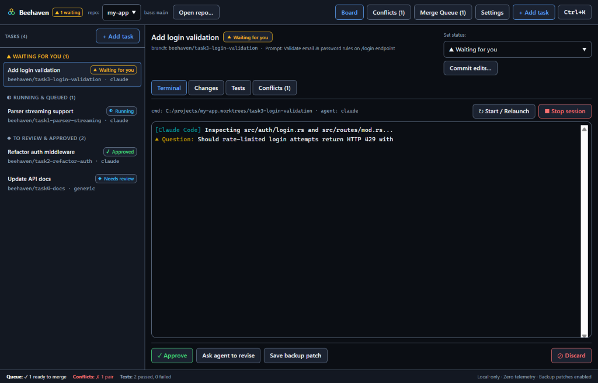

<p align="center">
  
</p>

<h1 align="center">Beehaven</h1>

<p align="center">
  <strong>Unleash five AI coding agents at once. Come back to five tested, conflict-checked branches ready to merge.</strong>
</p>

<p align="center">
  <a href="https://github.com/noodlestack/beehaven/releases/latest"></a>
  <a href="LICENSE"></a>
  
</p>

---



## Why Beehaven?

Running **one** AI coding agent (`Claude Code`, custom CLI scripts, or terminal shells) is slow—you spend half your day watching a cursor type.

Running **five** coding agents at the same time in one folder is pure chaos:
- They overwrite each other's files while working.
- One agent pauses to ask a `y/n` question in a buried tab and silently stalls for 30 minutes.
- Even when two agents both pass tests on their own, merging them together breaks `main`.

**Beehaven turns parallel coding agents into a calm, orderly hive.** It is a fast, native desktop app (~4 MB installer, zero cloud accounts, zero telemetry) that gives every agent its own isolated copy of your repo, forecasts branch collisions *before* you merge, and lands your approved work through an automatic test-gated merge queue.

---

## How Beehaven Works (In Plain English)

| Step | What Happens | Why You'll Love It |
| :--- | :--- | :--- |
| **1. Each Bee Gets Its Own Cell** | Add a task, and Beehaven creates a private side-by-side working copy of your repo (`<repo>.worktrees/`) on its own `beehaven/` Git branch. | Run 4+ agents in parallel on the same codebase—zero stepped-on files, zero `index.lock` errors. |
| **2. Calm Until Needed (`▲ Waiting for you`)** | Beehaven connects to **Claude Code hooks** (and monitors terminal silence for any other CLI). | No noisy blinking tabs. Only agents waiting on an answer jump straight to the top of your board. |
| **3. One-Screen Review** | Click any task to see its **live Terminal**, **Unified or Side-by-Side Diff**, and **Test Runner** in one place. | Review what changed and run your test command in one click without juggling five terminal windows. |
| **4. Honeycomb Conflict Forecast** | Behind the scenes, Beehaven simulates real 3-way merges (`git merge-tree`) across *every pair* of active task branches. | Spot exact colliding files (`✗ 2 files`) *before* anything merges, see the cleanest suggested merge order, or click **Ask agent to resolve**. |
| **5. The Queen's Gate (Merge Queue)** | Select your `✓ Approved` tasks and press **Merge**. Beehaven rebases Task 1 onto `main`, runs your test suite in a clean folder, fast-forwards `main` if green, then rebases Task 2 on top and re-tests. | If a test fails or a conflict hits on Task 2, the queue stops cleanly, leaves `main` safe at Task 1, and keeps all logs intact. |

---

## Install & Try It in 60 Seconds

### Option A — Download the Ready-to-Run Installer (Recommended)

1. Go to **[Beehaven Releases](https://github.com/noodlestack/beehaven/releases/latest)** and download either:
   - **`Beehaven_0.1.0_x64-setup.exe`** (Windows Setup Wizard — `3.5 MB`)
   - **`Beehaven_0.1.0_x64_en-US.msi`** (Windows MSI Package — `5.0 MB`)
2. Make sure **Git 2.38+** is installed (`git --version`). *(If Windows SmartScreen warns about a new unsigned open-source app, click **More info → Run anyway**.)*
3. Open **Beehaven** and pick how you want to start:
   - **Want to test-drive it safely first?** Click **`✓ Create Practice Sandbox`**! In one click, Beehaven generates a real sample Git repository with 4 branches, diffs, passing tests, and a live conflict matrix you can merge right away.
   - **Ready for your own project?** Click **`Open repo…`**, select any local Git repository, confirm your test command (auto-detected from `Cargo.toml`, `package.json`, `pyproject.toml`, or `go.mod`), and click **`+ Add task`**.

### Keyboard Shortcuts

- `Ctrl+K` / `Cmd+K` — Open Command Palette (jump to any task, screen, or action)
- `Alt+N` — Add a new parallel task
- `Alt+1` / `Alt+2` / `Alt+3` / `Alt+4` — Switch between **Board**, **Conflicts**, **Merge Queue**, and **Settings**

---

## Built-In Safety Guarantees

Your code is sacred. Beehaven enforces strict guardrails inside its Rust core:

- **No destructive Git commands:** Beehaven blocks `git clean`, `git reset --hard`, and `git push --force` at the command-runner level.
- **Automatic `.patch` backups:** Refuses to delete a dirty worktree without confirmation, and always saves a complete `.patch` backup (including brand-new untracked files) before discarding a task.
- **Crash-proof sessions:** All state lives in a local SQLite WAL database. If the window reloads, running terminals reconnect and replay their history; if your machine restarts mid-run, Beehaven reconciles every worktree cleanly on startup.
- **Accessible by design:** WCAG 2.1 AA verified Dark & Light themes, shape + text status badges (never color alone), full keyboard navigation, `prefers-reduced-motion` support, and `xterm.js` Screen-Reader Mode.
- **100% Private:** Local-only. No accounts, no cloud servers, no telemetry.

---

## Build From Source (Windows, macOS, Linux)

**Prerequisites:** Git `>= 2.38`, Rust `>= 1.90`, Node.js `>= 20`, `pnpm`, and [Tauri v2 OS prerequisites](https://v2.tauri.app/start/prerequisites/).

```bash
git clone https://github.com/noodlestack/beehaven.git
cd beehaven

# Install UI dependencies
pnpm install

# Run in development mode
pnpm tauri dev

# Run all quality, contrast, and integration test suites
pnpm contrast
pnpm lint && pnpm typecheck && pnpm test
cd src-tauri && cargo clippy --all-targets -- -D warnings && cargo test

# Build native OS installers (.exe / .msi / .dmg / .deb / .AppImage)
pnpm tauri build
```

---

## Project Docs

- [Architecture & Dependency Scorecards (`DECISIONS.md`)](DECISIONS.md)
- [Technical & Competitive Spike Report (`SPIKE-REPORT.md`)](SPIKE-REPORT.md)
- [WCAG 2.1 AA Contrast Report (`docs/STYLE-GUIDE.md`)](docs/STYLE-GUIDE.md)
- [Accessibility Audit (`docs/ACCESSIBILITY-REPORT.md`)](docs/ACCESSIBILITY-REPORT.md)
- [Release Notes (`RELEASE-NOTES.md`)](RELEASE-NOTES.md)

## License

MIT © [noodlestack](https://github.com/noodlestack)
